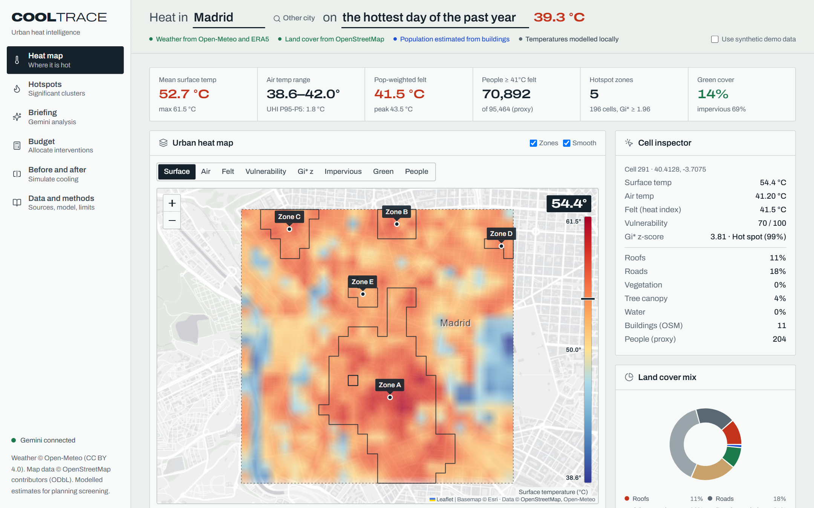
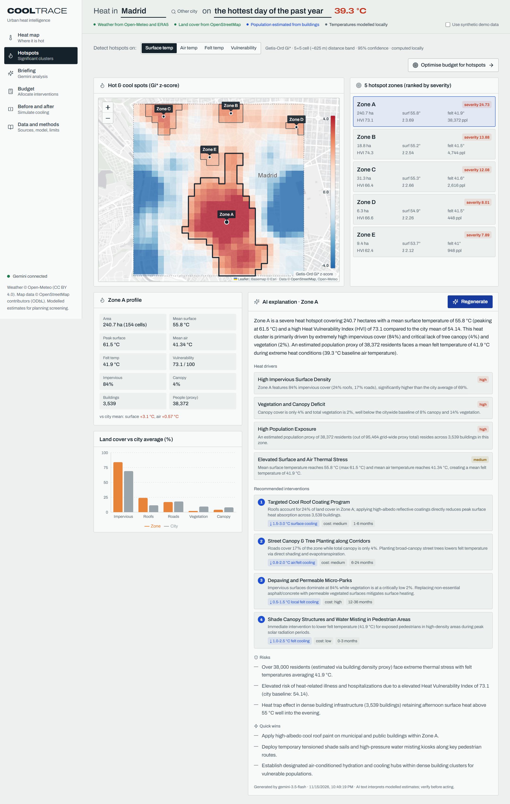
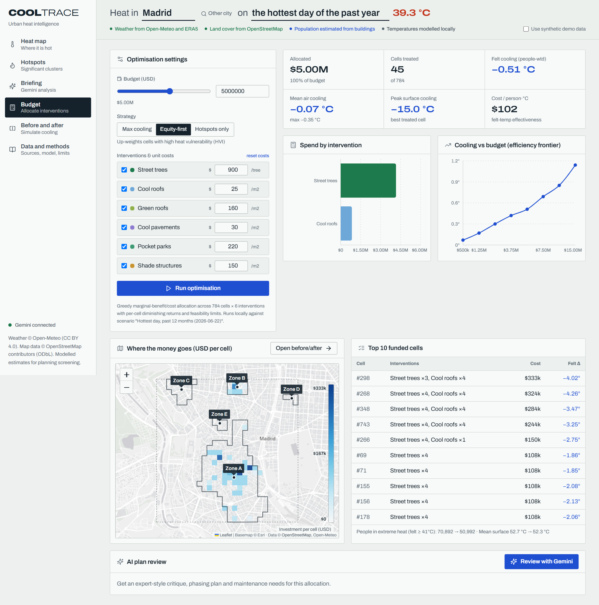
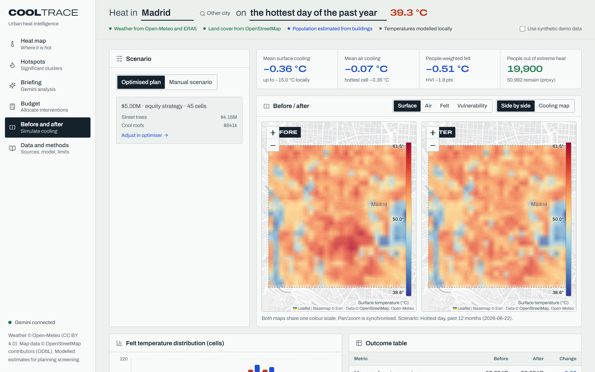
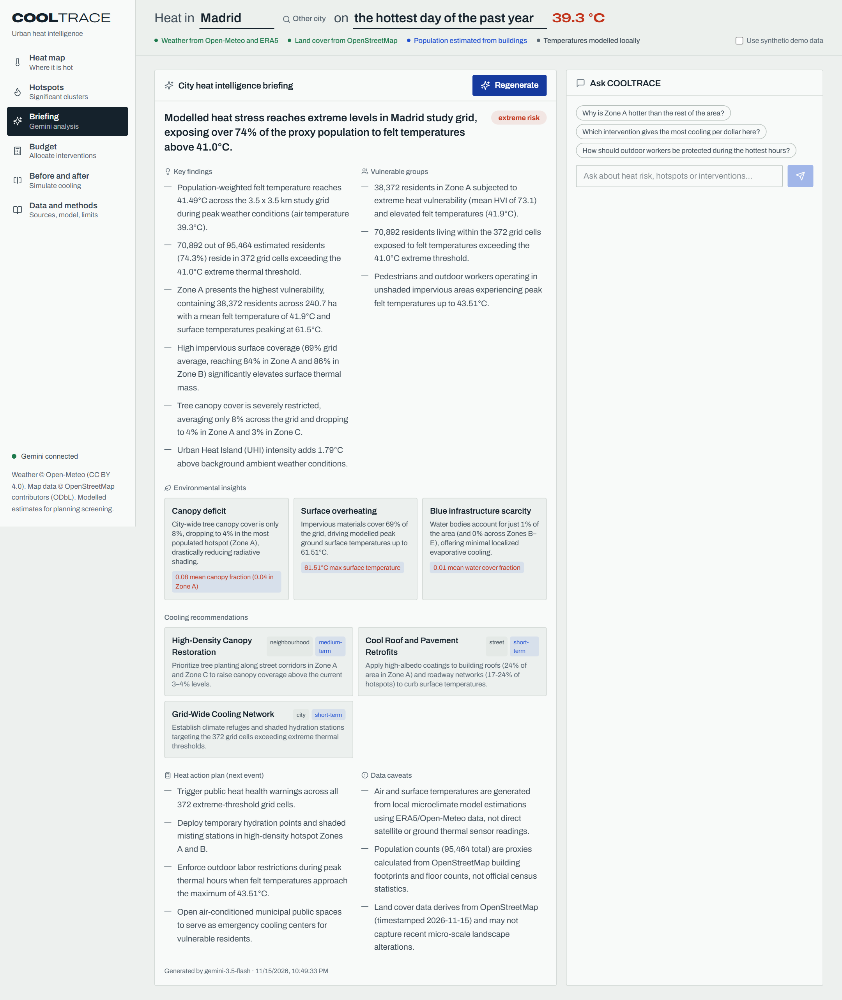

# COOLTRACE

**Find where a city overheats. Test what it would take to cool it.**

COOLTRACE is an urban heat intelligence tool for city resilience teams. It builds a 125 m heat model of any
city from public weather and map data, finds statistically significant hotspots, and asks **Google Gemini**
to explain them and recommend cooling measures. It also allocates an intervention budget and simulates the
before/after effect.



**Demo video:** [`docs/cooltrace-demo.mp4`](docs/cooltrace-demo.mp4) (1080p, about 80 seconds, original soundtrack)

## What it does

| Section | What you get | Where it runs |
|---|---|---|
| **Heat map** | Surface, air and felt temperature, vulnerability, Gi* z-score, impervious share, green cover and population layers on a 28 × 28 grid (about 125 m cells). It has a thermal-camera scale with a live cursor readout and a cell inspector, plus a 48 h forecast, the last 30 days and a 12-month ERA5 climatology. | Browser |
| **Hotspots** | Getis-Ord Gi* hot and cool spots, clustered into ranked zones and profiled against the city average. **Gemini** explains each zone's drivers, risks, prioritised interventions and quick wins. | Browser + Gemini |
| **Briefing** | **Gemini** writes a city briefing (findings, environmental insights, vulnerable groups, recommendations, heat action plan, data caveats) and answers questions grounded in the model output. | Gemini |
| **Budget** | Greedy marginal-benefit/cost optimiser across 6 interventions and 784 cells. Unit costs are editable, with 3 strategies: max cooling, equity-first and hotspots only. Shows an efficiency frontier, a spend map, the top funded cells and a **Gemini** plan review. | Browser + Gemini |
| **Before and after** | Simulates the optimised plan or a manual scenario, with synced maps, a cooling map, histograms and an outcome table. | Browser |
| **Data and methods** | Live provenance for every dataset, the model equations, assumptions and limitations. | Browser |

<table>
<tr><td></td><td></td></tr>
<tr><td></td><td></td></tr>
</table>

## Quick start

You need **Node.js 18.17 or newer** and a **Gemini API key** from [Google AI Studio](https://aistudio.google.com/apikey).
No other key or paid service is needed.

```bash
npm run setup                       # install root, server and client dependencies
cp server/.env.example server/.env  # then put your key in server/.env
npm run dev                         # API on :8787, app on http://localhost:5173
```

`server/.env`:

```env
GEMINI_API_KEY=your_key_here
GEMINI_MODEL=gemini-3.5-flash   # optional; falls back to gemini-flash-latest, gemini-3.5-flash-lite, gemini-3.8-flash
PORT=8787                       # optional
```

To run a production build on one port:

```bash
npm run build && npm start          # http://localhost:8787
```

Without a key the app still runs: maps, hotspots, the optimiser and the simulator work, and the AI panels
say how to enable Gemini.

## Data sources (free, no keys)

| Data | Source | How it is labelled |
|---|---|---|
| Current weather at 9 points, 7-day forecast, last 30 days | [Open-Meteo](https://open-meteo.com) forecast API | Real |
| Hottest day of the past 12 months, monthly climatology | Open-Meteo ERA5 archive | Real |
| Buildings and levels, roads, parks, water, trees and tree rows | OpenStreetMap via Overpass (4 mirrors, staggered) | Real |
| City search | Open-Meteo geocoding | Real |
| Population exposure | OSM building floor area ÷ 40 m² per person | Proxy |
| Surface, air and felt temperature | COOLTRACE heat model | Model |
| Fallback if a source fails, or by choice | Deterministic generator | **Synthetic** (warning badge) |

Responses are cached in `server/data/cache/`: OSM for 30 days, weather for 30 minutes.

## Architecture

```
Browser (React, Leaflet, Recharts)                     Server (Express)
  lib/features.js   rasterise OSM to surface fractions   /api/environment  Open-Meteo + Overpass, cache, fallback
  lib/model.js      surface / air / felt temp, HVI        /api/geocode      Open-Meteo geocoding
  lib/hotspots.js   Getis-Ord Gi*, zone clustering        /api/ai/*         Gemini JSON mode: hotspot,
  lib/optimizer.js  interventions + budget knapsack                         insights, plan-review, ask
  lib/outcomes.js   before/after metrics                  gemini.js         key from .env, model fallback,
                                                                            timeouts, error mapping
```

- **The Gemini key never reaches the browser.** Only `server/src/gemini.js` reads it, and sends it in the
  `x-goog-api-key` header. AI routes are rate-limited (20 requests/min per IP), input is validated, and
  request bodies are capped at 300 KB.
- **The numbers come from the local model, not from Gemini.** Gemini receives the computed statistics and
  returns structured JSON, which the UI renders defensively.

### The model in one paragraph

Each cell's surface temperature is `Ta + R·Σ fᵢ·ΔTᵢ`: the full-sun excess of each surface type (dark roof +22 °C,
asphalt +18, paving +13, bare soil +9, vegetation +2, canopy −1, water −2, green roof +4) weighted by its share
of the cell. Albedo rescales roof and road excess, and canopy shades the ground under it. Air temperature adds
an inverse-distance-weighted offset from 9 weather samples, plus a wind-damped share of the neighbourhood-smoothed
surface excess. Felt temperature is the NOAA heat index plus a radiant term reduced by shade. The heat vulnerability
index is 50% exposure, 30% population sensitivity and 20% lack of green access.

## Tests

```bash
npm test
```

This runs 21 tests: 8 server tests (`node:test`: validation, missing or invalid key, OSM parsing, synthetic
labelling) and 13 engine tests (`vitest`: rasterisation, heat model, Gi*, optimiser budget limits and
monotonicity). The tests never call Gemini.

## Design

The interface uses a "planning atlas" system. A cool concrete paper background with asphalt-ink type is
meant to read like a planning document rather than a dark dashboard. Heat colours appear only in data, and
survey blue is the only interface accent, so blue always means an action. One typeface, Archivo, carries the
whole interface, with its width axis as the typographic device: expanded for the wordmark and readouts,
normal width for reading.

The one orchestrated motion is the map "developing" like a thermal image under a scan line when data loads
or a layer changes. Everything else moves only in response to the user. Reduced-motion preferences are respected.

## Demo video

The video in `docs/` is produced from the running app by scripts in [`video/`](video):

```bash
cd video && npm install
node capture.mjs          # records real app footage via the Chrome DevTools screencast (app must be running)
node prep.mjs             # computes the Madrid heat grid used in the intro
node render.mjs           # renders the motion-graphic edit at 1080p30 and encodes MP4 with ffmpeg
node shots.mjs            # refreshes docs/screenshots
```

`comp.html` is the motion-graphics composition and `audio.mjs` synthesises the original soundtrack.
Gemini responses in the video are live; only the waiting time is cut, and the video labels that on screen.

## Limitations

- Temperatures are screening-level model estimates, not satellite land-surface temperature.
- OSM completeness varies by city. Sparsely mapped areas under-count buildings and trees.
- Population is a proxy. Intervention costs are indicative USD values, so edit them in the optimiser.
- Gemini output interprets modelled numbers. Review it before acting on it.

## Project layout

```
client/   React app (Vite, Tailwind CSS v4); analytics engine in src/lib, tests in src/test
server/   Express API, Gemini client, data acquisition, tests
video/    Footage capture, motion-graphic composition, soundtrack and render scripts
docs/     Screenshots and the demo video
```

## Licence and attribution

Code is released under the MIT licence (see [LICENSE](LICENSE)).
Weather data © Open-Meteo.com (CC BY 4.0), ERA5 © Copernicus/ECMWF. Map data © OpenStreetMap contributors (ODbL).
Basemap © Esri. AI by Google Gemini.
