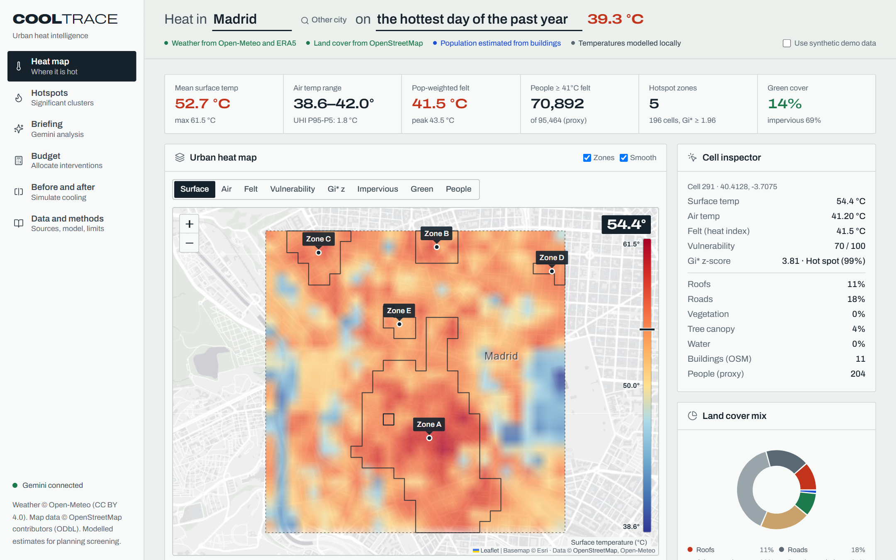

# COOLTRACE: urban heat intelligence for any city

**Find where a city overheats. Test what it would take to cool it.**

- **Code:** https://github.com/TECH-SQUAD7/cooltrace
- **Demo video (82 s, 1080p):** https://github.com/TECH-SQUAD7/cooltrace/blob/main/docs/cooltrace-demo.mp4
- **Run it:** `npm run setup`, add a Gemini key to `server/.env`, then `npm run dev`



## The problem

Heat is one of the deadliest weather hazards, and it is unevenly distributed inside a city. A block of dark
roofs and asphalt can run several degrees hotter than a tree-lined street a few hundred metres away. Resilience
teams know they should plant trees, coat roofs and add shade. But most small and mid-sized cities cannot answer
three practical questions:

1. **Where** exactly is it hottest, and is that pattern real or noise?
2. **Why** is that place hot, in terms a council can act on?
3. **What** would a given budget actually buy, in degrees and in people protected?

Commercial heat studies and satellite thermal analyses answer these, but they cost money, time and GIS
expertise. COOLTRACE gives a first answer in under a minute, for any city, from public data and one Gemini key.

## What it does

COOLTRACE has six sections, which follow a planner's workflow:

| Section | What it gives you |
|---|---|
| **Heat map** | A 28 × 28 grid (~125 m cells) over a 3.5 × 3.5 km area. Layers show surface, air and felt temperature, heat vulnerability, hotspot statistics, impervious share, green cover and population. A thermal-camera scale shows the live value under your cursor. |
| **Hotspots** | Getis-Ord Gi* separates statistically significant hot clusters (95% confidence) from random warm cells and groups them into ranked zones. **Gemini explains each zone**: its drivers, who is at risk, and prioritised interventions with expected cooling, cost and timeframe. |
| **Briefing** | **Gemini writes a city heat briefing** with key findings, environmental insights, vulnerable groups, recommendations, a heat action plan for the next event, and data caveats. A Q&A box answers follow-up questions grounded in the model output. |
| **Budget** | Allocates a budget across six interventions (street trees, cool roofs, green roofs, cool pavements, pocket parks, shade structures) over every cell. Unit costs are editable, with three strategies: max cooling, equity-first and hotspots only. It plots a cooling-vs-budget curve, and **Gemini reviews the plan** with a score, gaps, phasing and maintenance needs. |
| **Before and after** | Simulates the optimised plan or a hand-built scenario on synced side-by-side maps, with a cooling map, temperature distributions and an outcome table. |
| **Data and methods** | Live provenance for every dataset, the model equations and their limits. |

**An example run (Madrid, hottest day of the past 12 months, 22 June 2026, 39.3 °C air):**

- The model estimates surfaces up to 61.5 °C and finds 5 significant hotspot zones.
- The largest, Zone A, covers 240.7 ha with 84% impervious cover and 4% tree canopy, affecting about 38,000 residents (building-based estimate).
- Gemini's explanation cites exactly those numbers and ranks cool roofs and street trees first.
- In the max-cooling run used for the demo video, a $33.9M plan lowers people-weighted felt temperature by about 2 °C.

## How we built it

```
Browser (React, Leaflet, Recharts)            Server (Node, Express)
  rasterise land cover -> surface fractions     /api/environment  Open-Meteo + OpenStreetMap
  heat model: surface / air / felt, HVI                           (cache, mirrors, labelled fallback)
  Getis-Ord Gi* hotspots + zone clustering      /api/ai/*         Google Gemini, JSON mode
  budget optimiser + before/after simulator                       key read from .env only
```

**Local analytics, not AI arithmetic.** Every number is computed deterministically in the browser:

- **Surface temperature:** each cell's surface mix (roofs, roads, paving, bare soil, vegetation, canopy, water) is weighted by that surface type's full-sun excess temperature, scaled by solar radiation. Albedo changes and tree shade modify it.
- **Air temperature:** follows the neighbourhood-smoothed surface heat, damped by wind.
- **Felt temperature:** the NOAA heat index plus a radiant term.
- **Vulnerability index:** combines exposure, population and lack of nearby green space.
- **Budget optimiser:** a greedy marginal benefit-per-dollar knapsack with diminishing returns per cell. A full optimisation over 784 cells takes about 30 ms.

**Gemini as the interpreter.** The server sends Gemini the computed statistics, never raw guesses. It asks for
structured JSON (hotspot explanation, city briefing, plan review, Q&A), parses it defensively, and renders it.
The prompts tell Gemini to cite only the supplied numbers and to flag proxy or synthetic data.

**Public data only.**
- **Weather:** Open-Meteo forecast at 9 sample points, plus the past 30 days.
- **Climate:** ERA5 reanalysis for the hottest day of the past year and a monthly climatology.
- **City search:** Open-Meteo geocoding.
- **Land cover:** OpenStreetMap buildings, roads, parks, water and trees via the Overpass API.

No satellite data is used, and the app says so.

**Security.** The Gemini key lives only in `server/.env`, which is git-ignored, and is sent only in a server-side
header. AI routes are rate-limited, input-validated and size-capped.

**Design.** The interface follows a "planning atlas" system rather than a dark dashboard:
- Cool concrete paper with asphalt ink.
- Heat colours reserved for data; one survey-blue accent for actions.
- One typeface, Archivo, whose width axis carries the hierarchy.
- One signature animation: the map develops like a thermal image under a scan line.

**Stack:** React 18, Vite 6, Tailwind CSS 4, Leaflet 1.9 / React Leaflet, Recharts, Express, Google Gemini API.
21 automated tests cover the API and the analytics engine.

## Challenges we ran into

- **Public map servers are slow and busy.** The first Overpass queries hit "server at capacity" errors and took
  30–40 s. We added staggered requests across four mirrors, a 30-day disk cache, and a deterministic synthetic
  fallback. The fallback is badged **Synthetic** everywhere so it is never mistaken for real data.
- **Gemini models moved under us.** The 2.x Flash models we started with were closed to new users, and one newer
  model was overloaded. We listed the models available to the key, made `gemini-3.5-flash` the default, and
  added an automatic fallback chain with clear error messages for bad keys, quota limits and timeouts.
- **Thinking tokens truncating JSON.** Newer models spend output budget on reasoning, which could cut off
  structured answers. We raised the output limit and made the JSON parser tolerant of code fences.
- **Uneven OpenStreetMap coverage.** Central New Delhi has about 110 mapped trees while Madrid has over 9,000.
  We added multipolygon parks and tree rows, and surfaced data completeness in the app instead of hiding it.
- **A basemap that started asking for a key.** Our first tile provider began watermarking tiles with "API key
  required", so we switched to key-free Esri canvas tiles.

## Accomplishments we're proud of

- It works for **any city on Earth** from one search box, with **only a Gemini key**. No paid data, GIS
  software or setup beyond `npm`.
- Hotspots come from a **real significance test**, not a colour threshold, so planners can defend them.
- Gemini's explanations are **grounded and checkable**: they quote the model's own numbers.
- Every dataset is labelled as **real, proxy, modelled or synthetic**, in the interface and in the README.
- The demo video was **produced from the running app by code**: scripted screen capture, a motion-graphics
  composition rendered frame by frame, and a procedurally generated soundtrack. It is fully reproducible from
  the repo.

## What we learned

- Language models are most trustworthy when they explain numbers rather than produce them. Splitting
  "compute locally, interpret with Gemini" made the AI output both more useful and easier to verify.
- Being honest about data quality (badges, caveats, fallbacks) matters as much as the model itself for a
  tool meant to inform public spending.

## What's next

- Add satellite land-surface temperature (Landsat 8/9 thermal bands) to calibrate and validate the model.
- Replace the building-based population estimate with census or WorldPop grids.
- Add night-time heat-island modelling and multi-day heatwave scenarios.
- Export the briefing and plan as a PDF for council meetings.
- Support larger study areas and side-by-side city comparisons.

## Limitations

COOLTRACE is a screening tool. Its temperatures are modelled estimates, not measurements. Population is
estimated from buildings. Intervention costs are indicative USD values that users should edit. Gemini's text
interprets the model and should be reviewed before acting on it.

## Built with

Google Gemini API, Leaflet, OpenStreetMap (Overpass API), Open-Meteo (forecast, ERA5 archive, geocoding),
Esri basemap, React, Vite, Tailwind CSS, Recharts, Lucide, Express, Node.js, Vitest, Playwright and FFmpeg
(demo video only), Archivo typeface. Built with **Claude** (Anthropic) as the AI coding assistant. No satellite
data and no Python are used. Full credits are in the [README](README.md#credits-and-acknowledgements).
